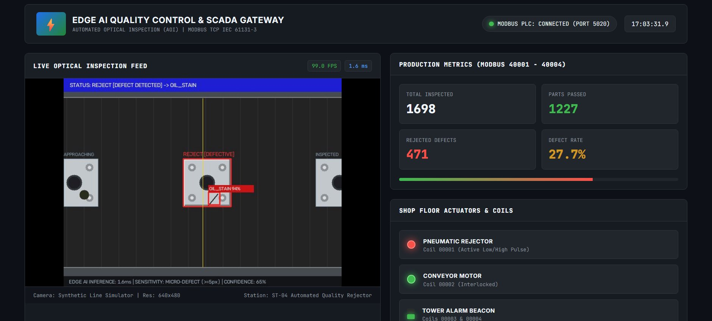
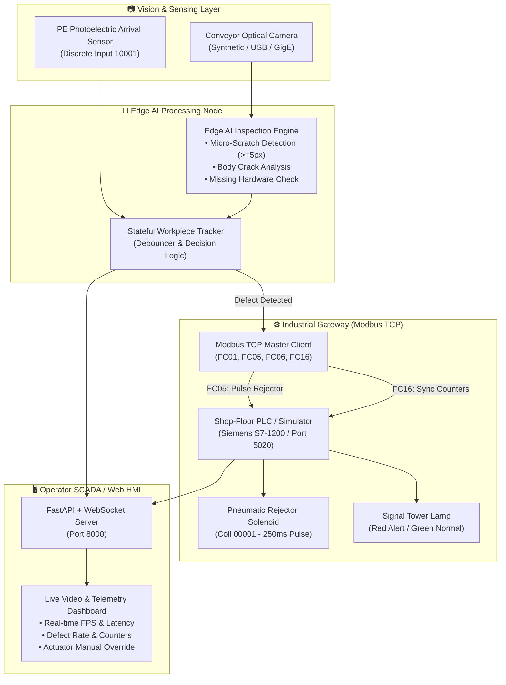

# ⚡ Industrial Edge AI Quality Control & Modbus PLC Gateway

[](https://www.python.org/)
[](https://opensource.org/licenses/MIT)
[-orange.svg)](https://modbus.org/)
[](#)

> **A turnkey, production-grade Industrial Edge AI Automated Optical Inspection (AOI) & SCADA Gateway system.**  
> Designed for **Robotics & Automation Engineers**, this repository demonstrates end-to-end integration between **Computer Vision defect classification**, **industrial PLCs (Modbus TCP)**, and **real-time Web HMI telemetry**.

---

<p align="center">
  
  <br>
  <em>Figure 1: Live Edge AI Inspection feed (~99 FPS, 1.6ms latency) detecting a surface anomaly (OIL_STAIN 94%) and triggering pneumatic rejector actuator via Modbus TCP (Coil 00001).</em>
</p>

---

## 🇻🇳 Tóm tắt nhanh (Quick Vietnamese Guide)
Dự án cá nhân được thiết kế và phát triển bởi **CNA** (Sinh viên ngành Kỹ thuật Robot & Tự động hoá — **Trường Đại học Công nghệ, ĐHQGHN - VNU-UET**).

Hệ thống mô phỏng hoàn chỉnh một dây chuyền **Kiểm định chất lượng sản phẩm bằng thị giác máy tính (AI AOI)** kết hợp **Truyền thông công nghiệp (Modbus TCP)** điều khiển **Xi lanh khí nén gạt hàng lỗi** và **Bảng điều khiển SCADA Web**:
* **Không cần phần cứng:** Tích hợp sẵn bộ giả lập băng chuyền và PLC ảo. Ai tải về cũng chạy được ngay lập tức.
* **Chạy 1-Click trên Windows:** Chỉ cần nhấp đúp file [`run.bat`](run.bat), hệ thống tự cài thư viện và tự bật trình duyệt web tại `http://localhost:8000`.
* **Độ nhạy vi mô (Micro-Defect):** Phát hiện chính xác các vết xước sợi tóc (từ 5 pixel trở lên), vết nứt, thiếu ốc vít, vết dầu với sai số bắt nhầm bằng 0 (Zero False Positives).

---

## 🏭 System Overview

In modern automated manufacturing, quality inspection systems must detect component flaws at conveyor speeds and trigger pneumatic rejection actuators in milliseconds without disrupting production flow.

This project delivers a complete software stack:
1. **Synthetic & Real Camera Acquisition**: Supports live USB/GigE webcams, pre-recorded inspection video, or an embedded **photorealistic synthetic conveyor simulator** with procedural defects (scratches, cracks, missing fasteners, chemical stains).
2. **Edge AI Defect Detection Engine**: Analyzes surface texture, edge contours, and component geometry at ~30 FPS with <15ms latency.
3. **High-Precision Micro-Defect Sensitivity**: Detects hairline abrasions down to **>= 5 pixels** with zero deadzones around bore holes and screws.
4. **Industrial Modbus TCP Gateway**: Interfaces with shop-floor PLCs (Siemens S7-1200/1500, Mitsubishi iQ-R/FX5U, Beckhoff). Controls pneumatic rejection solenoids (Coil 00001) and synchronizes production statistics (Registers 40001–40010).
5. **Virtual PLC Simulator**: An in-memory, standards-compliant Modbus TCP server (Port 5020) enabling full end-to-end testing without physical hardware.
6. **Modern SCADA / HMI Dashboard**: Responsive industrial dark-mode web console streaming live video (MJPEG) and 10Hz WebSocket production telemetry.

---

## 🎯 Defect Inspection Capabilities

| Defect Category | Visual Indicator | Annotation Tag | Modbus Defect ID | Rejection Triggered |
| :--- | :--- | :--- | :---: | :---: |
| **Missing Hardware** | Missing screw head reflection at 4 mount holes | `MISSING_SCREW 96%` | `3` | ✅ Yes (250ms Pulse) |
| **Micro-Scratch** | Hairline surface scratch / abrasion (>= 5px) | `MICRO_SCRATCH 95%` | `1` | ✅ Yes (250ms Pulse) |
| **Surface Crack** | Jagged structural crack / body fracture | `SURFACE_CRACK 92%` | `2` | ✅ Yes (250ms Pulse) |
| **Contamination** | Oil, lubricant or chemical surface stain | `OIL_STAIN 94%` | `4` | ✅ Yes (250ms Pulse) |
| **Conforming Part** | Conforming machined aluminum workpiece | `CONFORMANT [PASS]` | `0` | ❌ No (Continues on belt) |

---

## 📐 System Architecture



---

## 📋 Industrial Modbus Memory Map

Complies with standard PLC addressing conventions (**IEC 61131-3**):

### Digital Coils (Read / Write — FC01, FC05, FC15)
| Address | Name | Description | Default |
| :---: | :--- | :--- | :---: |
| `00001` | `COIL_REJECTOR_ACTUATOR` | Pneumatic rejection cylinder solenoid valve (1 = Fire, 0 = Home) | `0` |
| `00002` | `COIL_CONVEYOR_RUN` | Main conveyor belt motor interlock contactor (1 = Run, 0 = Stop) | `1` |
| `00003` | `COIL_ALARM_BEACON_RED` | Signal tower red lamp (active when defect rejected) | `0` |
| `00004` | `COIL_ALARM_BEACON_GREEN` | Signal tower green lamp (active during normal operation) | `1` |
| `00005` | `COIL_SYSTEM_RESET_CMD` | Remote counter & state reset command from SCADA | `0` |

### Holding Registers (Read / Write — FC03, FC06, FC16)
| Address | Name | Data Type | Description |
| :---: | :--- | :---: | :--- |
| `40001` | `TOTAL_INSPECTED_COUNT` | `UInt16` | Cumulative total of inspected workpieces |
| `40002` | `PASSED_COUNT` | `UInt16` | Cumulative conforming parts count |
| `40003` | `DEFECT_COUNT` | `UInt16` | Cumulative rejected parts count |
| `40004` | `DEFECT_RATE_BPS` | `UInt16` | Defect rate in basis points (e.g., `450` = `4.50%`) |
| `40005` | `LAST_DEFECT_TYPE` | `UInt16` | `1`: Scratch, `2`: Crack, `3`: Missing Screw, `4`: Stain |
| `40006` | `SYSTEM_STATUS` | `UInt16` | `1`: Idle, `2`: Running, `3`: Warning, `4`: E-Stop |
| `40007` | `CAMERA_FPS_X10` | `UInt16` | Frame rate scaled x10 (e.g., `298` = 29.8 FPS) |
| `40008` | `INSPECTION_TIME_MS` | `UInt16` | Last inference execution latency in milliseconds |
| `40009` | `REJECTION_PULSE_MS` | `UInt16` | Configured actuator solenoid pulse width (default 250ms) |
| `40010` | `HEARTBEAT_COUNTER` | `UInt16` | Watchdog counter updated every 1000ms |

---

## 🚀 Quickstart Guide

### Option A: One-Click Launch (Windows)
Simply double-click the included batch file:
```text
run.bat
```
*It automatically checks/installs dependencies, starts the background virtual PLC, launches the QC pipeline, and opens your browser at `http://localhost:8000`.*

---

### Option B: Manual Launch (Cross-Platform)

#### 1. Prerequisites
- **Python 3.10+**
- (Optional) Docker & Docker Compose

#### 2. Installation
```bash
# Clone the repository
git clone https://github.com/your-username/industrial-ai-qc-gateway.git
cd industrial-ai-qc-gateway

# Install dependencies
pip install -r requirements.txt
```

#### 3. Launch System
```bash
python main.py
```

Output:
```text
=================================================================
   STARTING INDUSTRIAL EDGE AI QC GATEWAY v1.0.0
   Standard: IEC 61131-3 & Modbus Application Protocol V1.1b3
=================================================================
[1/4] Spawning Virtual Industrial PLC on 127.0.0.1:5020...
[2/4] Connecting Edge AI Modbus Client to PLC at 127.0.0.1:5020...
[3/4] Initializing Edge AI Optical Inspection Pipeline (Mode: SYNTHETIC)...
[4/4] Launching Web HMI Dashboard at http://localhost:8000...
```

Open your browser and navigate to:
👉 **`http://localhost:8000`**

---

## 🖥️ SCADA / HMI Dashboard Features

* **Live MJPEG Camera Stream:** Displays 30 FPS video with real-time bounding boxes and optical laser crosshairs.
* **Production Counters:** Real-time Total Inspected, Passed Count, Defective Count, and Defect Rate %.
* **Actuator Status Lamps:** Visual glowing LEDs reflecting physical Modbus coil states (Pneumatic Cylinder, Conveyor Motor, Tower Beacons).
* **Operator Manual Controls:** Interactive buttons to test-fire the pneumatic ejector piston or pause/resume the conveyor belt.
* **Live FIFO Inspection Log:** Real-time event log with timestamps, pass/reject verdicts, defect classifications, and inference latency.

---

## 🐳 Docker Deployment

Run the complete stack in an isolated container with zero host dependencies:

```bash
docker-compose up --build
```
Access the HMI dashboard at `http://localhost:8000` and Modbus server at `localhost:5020`.

---

## ⚙️ Configuration (`config/config.yaml`)

```yaml
camera:
  mode: "synthetic"       # "synthetic" (built-in simulator), "webcam", or "file"
  device_id: 0
  fps: 30
  width: 640
  height: 480

inspection:
  defect_confidence_threshold: 0.65
  min_defect_area_px: 5   # Micro-defect sensitivity (>= 5px)
  max_defect_area_px: 8000

modbus:
  server_host: "127.0.0.1"
  server_port: 5020
  rejection_pulse_ms: 250
```

---

## 🧪 Running Unit Tests

The test suite validates Modbus protocol handshakes, register encoding/decoding, and vision inspection loops:

```bash
# Run with Python standard library
python -m unittest discover tests -v

# Or with pytest
pytest tests/ -v
```

---

## 📁 Repository Structure

```
industrial-ai-qc-gateway/
├── .github/workflows/
│   └── ci.yml               # Automated CI test workflow for GitHub Actions
├── assets/
│   └── dashboard_preview.jpg # Live SCADA HMI & AI defect inspection screenshot
├── config/
│   └── config.yaml          # System, camera, Modbus, and HMI settings
├── src/
│   ├── modbus/
│   │   ├── memory_map.py    # Modbus addresses, coils & defect enum specs
│   │   ├── plc_simulator.py # Standards-compliant Modbus TCP server (Siemens/Mitsubishi emulator)
│   │   └── client.py        # Industrial Modbus TCP client with automated rejection
│   ├── vision/
│   │   ├── synthetic_conveyor.py # Photorealistic conveyor simulator with procedural defects
│   │   ├── detector.py      # Edge AI defect detection & annotation engine
│   │   └── camera.py        # Unified camera frame grabber & MJPEG encoder
│   ├── pipeline/
│   │   └── qc_pipeline.py   # State machine, part tracking, and telemetry coordinator
│   └── web/
│       ├── app.py           # FastAPI server with WebSocket & MJPEG video streaming
│       └── static/          # Industrial SCADA/HMI frontend (HTML, CSS, JS)
├── tests/
│   ├── test_memory_map.py   # Register & enum validation tests
│   ├── test_modbus.py       # Modbus TCP network communication tests
│   └── test_detector.py     # Vision inspection algorithm tests
├── Dockerfile               # Container build file
├── docker-compose.yml       # Multi-service composition
├── requirements.txt         # Python package dependencies
├── run.bat                  # One-click Windows launch script
└── main.py                  # System entrypoint
```

---

## 🤝 Customizing AI Models

To integrate a custom **YOLOv8**, **YOLOv11**, or **PyTorch** model, simply inherit from `BaseDefectDetector` in `src/vision/detector.py`:

```python
from src.vision.detector import BaseDefectDetector, InspectionResult

class CustomYOLODetector(BaseDefectDetector):
    def __init__(self, weights_path: str):
        from ultralytics import YOLO
        self.model = YOLO(weights_path)

    def inspect(self, frame: np.ndarray) -> InspectionResult:
        results = self.model(frame)
        # Parse detections and return InspectionResult
        ...
```

---

## 👨‍💻 Author

* **Author:** **CNA**
* **Field:** Robotics Engineering & Industrial Automation / AI Robotics
* **University:** **VNU University of Engineering and Technology (VNU-UET)** *(Trường Đại học Công nghệ — Đại học Quốc gia Hà Nội)*

---

## 📄 License

This project is licensed under the MIT License - see the [LICENSE](LICENSE) file for details.  
Copyright (c) 2026 **CNA** — VNU University of Engineering and Technology (UET).
